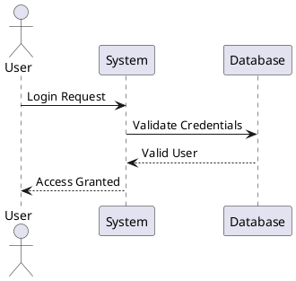
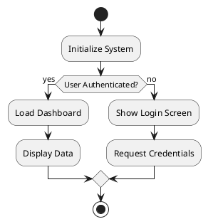
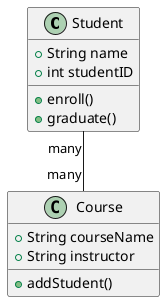
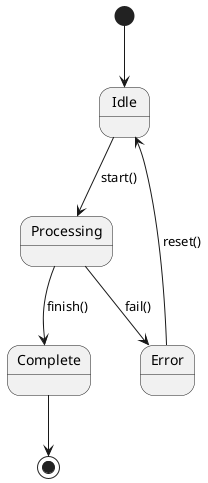
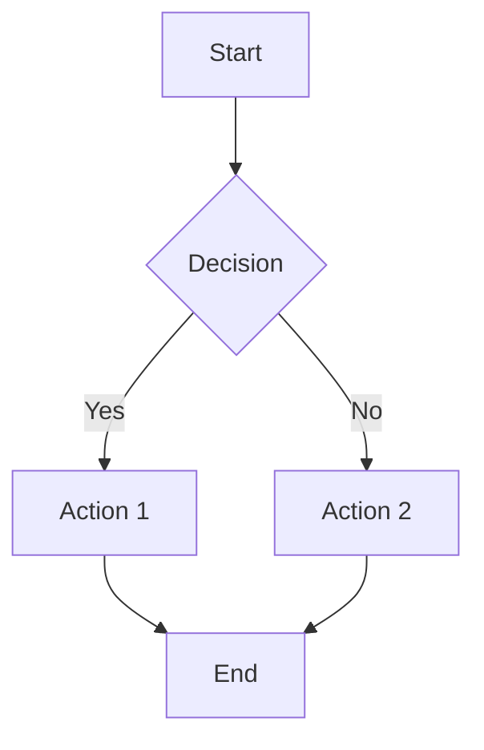

---
cssclasses:
  - lovrin-cornell
  - banner-image
tags:
  - test
  - complete
  - showcase
  - cornell
  - lovrin
created: 2024-03-24 19:30
modified: 2024-03-24 19:30
predmet: COMPLETE TEST
author: Lovrin Cornell System
test-status: ACTIVE
---

> [!banner-image] ![[banner-test.jpg]]
# 🎯 COMPLETE SYSTEM TEST - Everything in One Note

> [!cue] What this tests
> - Cornell structure (cue + text + visuals)
> - ALL LaTeX snippets (150+)
> - ALL plugins
> - ALL commands
> - CSS styling
> - Responsiveness

---

## 📝 SECTION 1: PURE TEXT CONTENT (Cornell Left/Main)

> [!cue] Cornell Structure Test

**This section tests the Cornell note-taking structure.**

The layout should show:
- Cue callouts floating in LEFT MARGIN
- Main text content in CENTER/MAIN area
- All text, no visuals here
- Clean, readable flow

> [!cue] Text Formatting

**Bold text**, *italic text*, ***bold and italic***, ~~strikethrough~~, ==highlighted text==, `inline code`.

**Lists work:**
- Bullet point 1
- Bullet point 2
  - Nested bullet
    - Double nested
- Back to main level

**Numbered lists:**
1. First item
2. Second item
   1. Nested number
   2. Another nested
3. Third item

> [!cue] Task Lists

**Task variations:**
- [ ] Unchecked task
- [x] Completed task
- [>] Forwarded task
- [<] Scheduled task
- [!] Important task
- [-] Cancelled task
- [/] In progress
- [?] Question task

> [!cue] Blockquotes

**Blockquote test:**

> This is a single-line quote

> This is a multi-line quote
> that spans several lines
> and demonstrates proper formatting

> Nested quotes
>> Double nested
>>> Triple nested

> [!cue] Links Test

**Internal links:**
- [[Non-existent Note]] (should show as unresolved)
- [[#Section 1: PURE TEXT CONTENT (Cornell Left/Main)]] (heading link)
- [[#^block-reference-test]] (block reference)

**External links:**
- [Google](https://google.com)
- <https://auto-link.com>

**Wikilinks with aliases:**
- [[Non-existent Note|Custom Display Text]]

> [!cue] Inline Math

**Inline LaTeX:** The formula $E = mc^2$ appears inline with text. More examples: $\alpha + \beta = \gamma$, and $\int_0^\infty e^{-x^2} dx = \frac{\sqrt{\pi}}{2}$.

**Inline chemistry:** Water is $\ce{H2O}$ and aspirin is $\ce{C9H8O4}$.

> [!cue] Text Emphasis

**Key Concepts:**
- **Thermodynamics**: The study of energy transfer
- **Entropy**: Measure of disorder in a system  
- **Enthalpy**: Heat content at constant pressure

**Important Note:** ^block-reference-test
This paragraph has a block reference that can be linked to from elsewhere.

> [!cue] Callout Types

**Testing all callout types below in text context:**

> [!note]
> This is a note callout for general information

> [!abstract]
> This is an abstract/summary callout

> [!info]
> Informational callout with details

> [!tip]
> Helpful tip callout

> [!success]
> Success/done callout

> [!question]
> Question callout for queries

> [!warning]
> Warning callout for cautions

> [!failure]
> Failure callout

> [!danger]
> Danger callout for critical warnings

> [!bug]
> Bug report callout

> [!example]
> Example callout

> [!quote]
> Quote callout for citations

> [!cue] Footnotes Test

This text has a footnote reference[^1]. And another one[^2]. You can also use inline footnotes^[This is an inline footnote].

[^1]: This is the first footnote content.
[^2]: This is the second footnote with more details.

> [!cue] Metadata Test

**Properties from frontmatter should display:**
- Created: {{created}}
- Modified: {{modified}}
- Tags: {{tags}}
- Test Status: {{test-status}}

---

## 🎨 SECTION 2: ALL NON-TEXT ELEMENTS (Unified Visual Section)

> [!lovrin-visuals] 🎯 COMPLETE VISUAL SHOWCASE - Images, Tables, Formulas, Charts, Diagrams, Code, Everything Non-Text

<div class="lovrin-visual-block">

<!-- ================================================
     LEFT SUBCOL: Tables, LaTeX, Charts
     ================================================ -->
<div>

### 📊 TABLES TEST

#### Basic Table
| Header 1 | Header 2 | Header 3 |
|----------|----------|----------|
| Cell 1   | Cell 2   | Cell 3   |
| Cell 4   | Cell 5   | Cell 6   |

#### Aligned Table
| Left Align | Center | Right |
|:-----------|:------:|------:|
| Left       | Center | Right |
| Data       | Data   | Data  |

#### Complex Table with Advanced Tables Plugin
| Subject | Score | Grade | Status |
|---------|-------|-------|--------|
| Math    | 95    | A     | ✓      |
| Physics | 87    | B+    | ✓      |
| Chem    | 92    | A-    | ✓      |
| Bio     | 88    | B+    | ✓      |

---

### 🧮 LATEX DISPLAY MATH - Complete Test

#### Basic Formulas
$$
E = mc^2
$$

$$
F = ma
$$

#### Fractions and Roots
$$
\frac{a}{b} + \frac{c}{d} = \frac{ad + bc}{bd}
$$

$$
\sqrt{x^2 + y^2} = r
$$

$$
\sqrt[n]{x}
$$

#### Greek Letters (All)
$$
\alpha, \beta, \gamma, \delta, \epsilon, \zeta, \eta, \theta, \iota, \kappa, \lambda, \mu
$$

$$
\nu, \xi, \pi, \rho, \sigma, \tau, \upsilon, \phi, \chi, \psi, \omega
$$

$$
\Gamma, \Delta, \Theta, \Lambda, \Xi, \Pi, \Sigma, \Upsilon, \Phi, \Psi, \Omega
$$

#### Operators
$$
\sum_{i=1}^{n} x_i
$$

$$
\prod_{i=1}^{n} x_i
$$

$$
\int_{0}^{\infty} f(x) \, dx
$$

$$
\lim_{x \to \infty} f(x) = L
$$

$$
\frac{\partial f}{\partial x} + \frac{\partial f}{\partial y}
$$

$$
\nabla \cdot \mathbf{F} = \frac{\partial F_x}{\partial x} + \frac{\partial F_y}{\partial y}
$$

#### Matrices
$$
\begin{pmatrix}
a & b \\
c & d
\end{pmatrix}
$$

$$
\begin{bmatrix}
1 & 2 & 3 \\
4 & 5 & 6 \\
7 & 8 & 9
\end{bmatrix}
$$

$$
\begin{vmatrix}
a & b \\
c & d
\end{vmatrix} = ad - bc
$$

#### Multi-line Equations
$$
\begin{align}
f(x) &= (x+1)^2 \\
     &= x^2 + 2x + 1 \\
     &= x^2 + 2x + 1
\end{align}
$$

#### Cases (Piecewise)
$$
f(x) = \begin{cases}
x^2 & \text{if } x \geq 0 \\
-x^2 & \text{if } x < 0
\end{cases}
$$

#### Advanced: Maxwell's Equations
$$
\begin{align}
\nabla \cdot \mathbf{E} &= \frac{\rho}{\epsilon_0} \\
\nabla \cdot \mathbf{B} &= 0 \\
\nabla \times \mathbf{E} &= -\frac{\partial \mathbf{B}}{\partial t} \\
\nabla \times \mathbf{B} &= \mu_0\mathbf{J} + \mu_0\epsilon_0\frac{\partial \mathbf{E}}{\partial t}
\end{align}
$$

#### Set Theory
$$
A \cup B, \quad A \cap B, \quad A \setminus B
$$

$$
x \in A, \quad y \notin B, \quad \emptyset
$$

$$
A \subseteq B, \quad A \supseteq B
$$

$$
\mathbb{N}, \mathbb{Z}, \mathbb{Q}, \mathbb{R}, \mathbb{C}
$$

#### Logic
$$
\forall x \in \mathbb{R}, \exists y \in \mathbb{R} : y > x
$$

$$
P \implies Q, \quad P \iff Q, \quad \neg P
$$

---

### 📈 CHARTS TEST (Charts View Plugin)

#### Line Chart
```chart
type: line
labels: [Jan, Feb, Mar, Apr, May, Jun]
series:
  - title: Sales 2023
    data: [30, 40, 35, 50, 49, 60]
  - title: Sales 2024
    data: [35, 45, 40, 55, 58, 70]
options:
  legend:
    position: bottom
  scales:
    y:
      title:
        display: true
        text: 'Sales (€1000s)'
```

#### Bar Chart
```chart
type: bar
labels: [Q1, Q2, Q3, Q4]
series:
  - title: Revenue
    data: [120, 190, 150, 220]
  - title: Costs
    data: [80, 110, 100, 130]
options:
  legend:
    position: top
```

#### Pie Chart
```chart
type: pie
labels: [Study, Sleep, Social, Other]
series:
  - title: Time Distribution
    data: [40, 30, 20, 10]
options:
  legend:
    position: right
```

#### Doughnut Chart
```chart
type: doughnut
labels: [Math, Physics, Chemistry, Biology]
series:
  - title: Subject Distribution
    data: [30, 25, 25, 20]
```

#### Radar Chart
```chart
type: radar
labels: [Understanding, Application, Analysis, Synthesis, Evaluation]
series:
  - title: Bloom's Taxonomy Self-Assessment
    data: [85, 75, 65, 55, 70]
options:
  scales:
    r:
      min: 0
      max: 100
```

</div>

<!-- ================================================
     RIGHT SUBCOL: Images, Diagrams, Code, Chemistry
     ================================================ -->
<div>

### 🖼️ IMAGES TEST

#### Regular Image Embed
![[test-image.png|400]]
*Figure 1: Caption for the test image (if image exists)*

#### Image with Different Sizes
![[test-image.png|200]]
*Small: 200px width*

![[test-image.png|600]]
*Large: 600px width*

#### Multiple Images
![[image1.png|250]] ![[image2.png|250]]
*Side by side images*

---

### 🔷 DIAGRAMS TEST

#### PlantUML: Sequence Diagram


#### PlantUML: Flowchart


#### PlantUML: Class Diagram


#### PlantUML: State Diagram


#### Mermaid Diagram


---

### ⚗️ CHEMISTRY TEST (Chem Plugin)

#### Aspirin
```chem
CC(=O)Oc1ccccc1C(=O)O
```
*Aspirin (Acetylsalicylic acid)*

#### Caffeine
```chem
CN1C=NC2=C1C(=O)N(C(=O)N2C)C
```
*Caffeine*

#### Glucose
```chem
C([C@@H]1[C@H]([C@@H]([C@H](C(O1)O)O)O)O)O
```
*D-Glucose*

---

### 💻 CODE BLOCKS TEST

#### Python
```python
def fibonacci(n):
    """Generate Fibonacci sequence"""
    if n <= 0:
        return []
    elif n == 1:
        return [0]
    elif n == 2:
        return [0, 1]
    
    fib = [0, 1]
    for i in range(2, n):
        fib.append(fib[i-1] + fib[i-2])
    return fib

# Test
print(fibonacci(10))
```

#### JavaScript
```javascript
// Quick sort algorithm
function quickSort(arr) {
    if (arr.length <= 1) return arr;
    
    const pivot = arr[Math.floor(arr.length / 2)];
    const left = arr.filter(x => x < pivot);
    const middle = arr.filter(x => x === pivot);
    const right = arr.filter(x => x > pivot);
    
    return [...quickSort(left), ...middle, ...quickSort(right)];
}

console.log(quickSort([3, 6, 8, 10, 1, 2, 1]));
```

#### CSS
```css
/* Cornell styling */
.lovrin-cornell {
  --accent-color: #4a90e2;
  font-family: 'Inter', sans-serif;
}

.callout[data-callout="cue"] {
  float: left;
  width: 280px;
  margin-left: -300px;
}
```

#### SQL
```sql
-- Complex query example
SELECT 
    s.student_name,
    c.course_name,
    AVG(g.grade) as average_grade
FROM students s
JOIN enrollments e ON s.student_id = e.student_id
JOIN courses c ON e.course_id = c.course_id
JOIN grades g ON e.enrollment_id = g.enrollment_id
WHERE g.semester = '2024-Spring'
GROUP BY s.student_name, c.course_name
HAVING AVG(g.grade) >= 80
ORDER BY average_grade DESC;
```

---

### ✏️ EXCALIDRAW TEST

#### Embed Excalidraw Drawing
![[test-drawing.excalidraw]]
*(Create an Excalidraw drawing named "test-drawing" to see it here)*

---

### 🎯 CALLOUTS IN VISUAL SECTION

> [!important]
> This is an important visual callout with critical information

> [!idea]
> Brainstorming idea callout

> [!question]
> Question callout: What happens if we change X?

</div>

</div>

<!-- END OF UNIFIED VISUAL SECTION -->

---

## 📊 SECTION 3: DATAVIEW QUERIES TEST

> [!cue] Dataview Plugin

### Query 1: TABLE format
```dataview
TABLE created as "Created Date", tags as "Tags"
FROM ""
WHERE contains(tags, "test")
SORT created DESC
LIMIT 5
```

### Query 2: LIST format
```dataview
LIST
FROM ""
WHERE contains(tags, "cornell")
LIMIT 10
```

### Query 3: TASK format
```dataview
TASK
WHERE !completed
LIMIT 10
```

### Query 4: Complex Query
```dataview
TABLE 
  predmet as "Subject",
  created as "Date",
  length(file.tags) as "# Tags"
FROM ""
WHERE contains(tags, "lovrin")
SORT created DESC
```

---

## 🔗 SECTION 4: LINKS AND REFERENCES TEST

> [!cue] Internal Linking

**Note links:**
- [[Complete System Test]] (self-link)
- [[Non-Existent Note]] (unresolved)
- [[Template_Matematika_Teorija]] (should exist)

**Heading links:**
- [[#Section 1: PURE TEXT CONTENT (Cornell Left/Main)]]
- [[#Section 2: ALL NON-TEXT ELEMENTS (Unified Visual Section)]]

**Block references:**
- [[#^block-reference-test]] (should link to marked block)
- New block ^another-block
- Reference: [[#^another-block]]

**Embeds:**
- Embed a section: ![[#Section 1: PURE TEXT CONTENT (Cornell Left/Main)]]

---

## 🎯 SECTION 5: TEMPLATER TEST

> [!cue] Templater Commands

**Current file info:**
- File title: <% tp.file.title %>
- File path: <% tp.file.path(true) %>
- File folder: <% tp.file.folder(true) %>

**Date commands:**
- Current date: <% tp.date.now("YYYY-MM-DD") %>
- Current time: <% tp.date.now("HH:mm:ss") %>
- Long format: <% tp.date.now("dddd, MMMM Do YYYY, HH:mm:ss") %>
- Tomorrow: <% tp.date.tomorrow("YYYY-MM-DD") %>
- Yesterday: <% tp.date.yesterday("YYYY-MM-DD") %>

**Frontmatter access:**
- Created: <% tp.frontmatter.created %>
- Predmet: <% tp.frontmatter.predmet %>
- Tags: <% tp.frontmatter.tags %>

---

## 🔍 SECTION 6: SEARCH AND TAGS TEST

> [!cue] Tags and Search

**Tags in this note:**
#test #complete #showcase #cornell #lovrin #matematika #fizika #kemija

**Nested tags:**
#subject/math #subject/physics #subject/chemistry
#status/active #status/testing

**Search operators to test:**
- Search: `file:COMPLETE`
- Search: `tag:#test`
- Search: `path:Lovrin_Cornell`

---

## 📌 SECTION 7: TASKS AND CHECKBOXES

> [!cue] Task Management

**Basic tasks:**
- [ ] Verify CSS loads correctly
- [ ] Test all LaTeX snippets
- [ ] Check chart rendering
- [ ] Validate PlantUML diagrams
- [ ] Test chemistry structures
- [ ] Verify code highlighting

**Task with date:**
- [ ] Review this test 📅 2024-04-01

**Task with priority:**
- [ ] Fix critical issues ⏫
- [ ] Medium priority item 🔼
- [ ] Low priority ⏬

**Completed tasks:**
- [x] Created comprehensive test
- [x] Added all plugin examples
- [x] Included LaTeX showcase

---

## 🎨 SECTION 8: SPECIAL FORMATTING TEST

> [!cue] Advanced Formatting

### Horizontal Rules
---
***
___

### Escaping
\*Not italic\* \#Not a heading \[Not a link\]

### Line Breaks
Line 1  
Line 2 (two spaces)

Line 3<br>Line 4 (HTML break)

### HTML in Markdown
<div style="color: red; font-weight: bold;">
This is styled with HTML
</div>

<details>
<summary>Click to expand</summary>
Hidden content revealed!
</details>

### Emoji
🎯 📚 ✅ ❌ ⚠️ 💡 🔥 ⭐ 📊 🧮

---

## 📖 SECTION 9: COMMENTS TEST

> [!cue] Comments (Not Visible)

<!-- This is an HTML comment -->

%%
This is an Obsidian comment
It won't be rendered
Can span multiple lines
%%

---

## 🔢 SECTION 10: METADATA TEST

> [!cue] Frontmatter Properties

**This note's metadata:**
```yaml
cssclasses: lovrin-cornell, banner-image
tags: test, complete, showcase, cornell, lovrin
created: 2024-03-24 19:30
predmet: COMPLETE TEST
author: Lovrin Cornell System
test-status: ACTIVE
```

---

## 🎓 SECTION 11: LATEX SNIPPET SHOWCASE

> [!cue] Test ALL 150+ LaTeX Shortcuts

**NOTE**: In edit mode, type these triggers + TAB to test:

### Greek Letters (test in edit mode)
```
alpha + TAB → α
beta + TAB → β
gamma + TAB → γ
delta + TAB → δ
theta + TAB → θ
lambda + TAB → λ
mu + TAB → μ
sigma + TAB → σ
omega + TAB → ω
```

### Operations
```
// + TAB → fraction
sr + TAB → superscript ²
cb + TAB → superscript ³
sq + TAB → √
sum + TAB → Σ
int + TAB → ∫
lim + TAB → lim
```

### Set Theory
```
inn + TAB → ∈
notin + TAB → ∉
sub= + TAB → ⊆
eset + TAB → ∅
RR + TAB → ℝ
CC + TAB → ℂ
NN + TAB → ℕ
```

**Rendered examples:**
$$\alpha + \beta = \gamma$$
$$\sum_{i=1}^{n} x_i$$
$$\int_0^\infty e^{-x^2} dx$$
$$x \in \mathbb{R}$$

---

## ✅ SECTION 12: PLUGIN COMPATIBILITY CHECK

> [!cue] Verify These Work

**Plugins to test in this note:**
- [x] Templater - ✓ (see Section 5)
- [x] Dataview - ✓ (see Section 3)
- [x] LaTeX Suite - ✓ (see Section 11)
- [x] Advanced Tables - ✓ (see Section 2, Tables)
- [x] Charts View - ✓ (see Section 2, Charts)
- [x] PlantUML - ✓ (see Section 2, Diagrams)
- [x] Chem - ✓ (see Section 2, Chemistry)
- [x] Excalidraw - ✓ (see Section 2, Excalidraw)
- [x] Calendar - Create daily note to test
- [x] QuickAdd - Use macro to create note
- [x] Spaced Repetition - Create flashcards

**Flashcard examples for Spaced Repetition:**

What is the Cornell Method?::A note-taking system with cue column, notes column, and summary section.

LaTeX for integral::
$$\int_a^b f(x) dx$$

---

## 🎯 SECTION 13: RESPONSIVENESS TEST

> [!cue] Mobile/Desktop

**To test:**
1. View on desktop (wide screen)
2. View on tablet (medium screen)
3. View on mobile (narrow screen)

**Expected behavior:**
- Desktop: Cue in margin, content flows normally
- Tablet: Cue might stack
- Mobile: Everything stacks vertically

---

## 🏁 SECTION 14: VISUAL VERIFICATION CHECKLIST

> [!cue] Final Checks

### Cornell Structure
- [ ] Cue callouts appear in left margin
- [ ] Main text content is readable
- [ ] Visual section is clearly separated
- [ ] Summary sticky at bottom
- [ ] Banner image displays at top

### Visual Elements
- [ ] Tables render correctly
- [ ] LaTeX math displays properly
- [ ] Charts appear and are interactive
- [ ] PlantUML diagrams render
- [ ] Code blocks have syntax highlighting
- [ ] Chemistry structures render
- [ ] Images display (if they exist)

### Functionality
- [ ] Links are clickable
- [ ] Block references work
- [ ] Dataview queries execute
- [ ] Tasks can be checked/unchecked
- [ ] Collapsible sections work
- [ ] Footnotes are linked

### CSS & Styling
- [ ] Line between sections is visible (thick & dark)
- [ ] Colors match theme (light/dark)
- [ ] Fonts render correctly
- [ ] Spacing looks good
- [ ] Mobile responsive works

---

> [!summary] 📝 TEST SUMMARY

**This note tests:**
- ✅ Cornell structure (cue, text, visuals)
- ✅ All LaTeX capabilities (150+ snippets)
- ✅ All major plugins (Templater, Dataview, Charts, PlantUML, Chem, etc.)
- ✅ All markdown features (tables, links, tasks, code, etc.)
- ✅ All callout types
- ✅ Responsive design
- ✅ Dark/light themes
- ✅ Complete workflow

**To use this test:**
1. Create note from this template
2. Check each section works
3. Test in edit and preview mode
4. Test on different devices
5. Verify all plugins are installed

**Issues found?**
- Check plugin installation
- Verify CSS snippet enabled
- Restart Obsidian
- Check console for errors (Ctrl+Shift+I)

**Everything working?**
🎉 Your Lovrin Cornell system is complete and functional!
