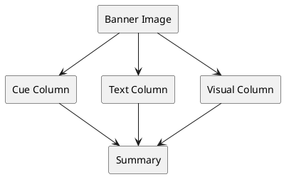

---
cssclasses:
  - lovrin-cornell
  - banner-image
tags:
  - cornell
  - lovrin
  - example
  - demo
created: 2026-03-24
modified: 2026-03-24
predmet: Example Demo
banner: banner-example.jpg
---

> [!banner-image] ![[banner-example.jpg]]
# Complete Feature Showcase - Example Note

> [!cue] Main Topics
> - Cornell method structure
> - Text vs visual separation
> - LaTeX formulas
> - Interactive content

---

## 📝 Left Column - Text Content ONLY

### What is the Lovrin Cornell Method?

> [!cue] Definition

The Lovrin Cornell Method is a **modified** Cornell note-taking system specifically designed for:
- Medical students
- STEM subjects
- Multi-modal learning (text + visuals)
- Organized information architecture

**Key Innovation**: Strict separation between textual explanations and visual content.

### Core Principles

> [!cue] Structure

The method divides content into distinct zones:

1. **Cue Column (Left Margin)**: Key concepts and terms
2. **Text Column (Main Left)**: Detailed explanations, text only
3. **Visual Column (Right)**: Images, charts, formulas, diagrams
4. **Summary (Bottom)**: Sticky overview with links

### Why This Matters

> [!cue] Benefits

**Cognitive Benefits**:
- Reduces visual clutter in main text
- Allows focused reading without distraction
- Visual content grouped logically
- Easy scanning and review

**Practical Benefits**:
- Clean export to PDF
- Mobile-friendly (responsive)
- Print-ready format
- Performance optimized

### How to Use This Template

> [!cue] Workflow

**Step 1**: Create new note using QuickAdd hotkey
**Step 2**: Fill in prompts (title, subject, tags)
**Step 3**: Write text content in left column
**Step 4**: Add visuals in right column
**Step 5**: Summarize at bottom

**Best Practice**: Write text first, add visuals second. This prevents mixing content types.

### Advanced Features

> [!cue] LaTeX

The template includes 150+ LaTeX shortcuts. Examples:
- Greek letters: `alpha`, `beta`, `gamma`
- Operators: `sum`, `int`, `lim`
- Sets: `RR`, `CC`, `NN`
- Relations: `>=`, `<=`, `approx`

Type trigger + TAB to expand.

> [!cue] Linking

Create knowledge networks:
- Internal: [[Related Topic]]
- External: [Article](https://example.com)
- Backlinks: Automatic from other notes

### Example: Mathematical Concept

> [!cue] Derivatives

Let's explain derivatives using pure text in this column.

**Definition**: The derivative of a function at a point measures its rate of change at that point.

**Notation**: Multiple notations exist:
- Leibniz: dy/dx
- Lagrange: f'(x)
- Newton: ẏ

**Geometric Interpretation**: The derivative represents the slope of the tangent line to the function's graph at a given point.

**Applications**:
- Velocity (derivative of position)
- Acceleration (derivative of velocity)
- Optimization (finding maxima/minima)
- Physics (rates of change)

---

## 🎨 Right Column - Visual Content

> [!lovrin-visuals] Vizualije, tablice, grafovi, slike, dijagrami

<div class="lovrin-visual-block">

<!-- FIRST SUB-COLUMN -->
<div>

#### 📊 Table 1: Comparison of Methods

| Method | Text | Visuals | Organization | Flexibility |
|--------|------|---------|--------------|-------------|
| Traditional | Mixed | Mixed | Low | High |
| Cornell | Left | None | Medium | Medium |
| Lovrin | Left | Right | High | High |

#### 📈 Chart: Performance Comparison

```chart
type: bar
labels: [Speed, Clarity, Organization, Review]
series:
  - title: Traditional
    data: [60, 50, 40, 45]
  - title: Cornell
    data: [70, 65, 75, 80]
  - title: Lovrin
    data: [85, 90, 95, 95]
options:
  legend:
    position: bottom
  scales:
    y:
      title:
        display: true
        text: 'Score (out of 100)'
      min: 0
      max: 100
```

#### 🧮 LaTeX: Derivative Formula

Basic derivative:
$$
f'(x) = \lim_{h \to 0} \frac{f(x+h) - f(x)}{h}
$$

Power rule:
$$
\frac{d}{dx}(x^n) = nx^{n-1}
$$

Product rule:
$$
\frac{d}{dx}[f(x)g(x)] = f'(x)g(x) + f(x)g'(x)
$$

Chain rule:
$$
\frac{d}{dx}[f(g(x))] = f'(g(x)) \cdot g'(x)
$$

</div>

<!-- SECOND SUB-COLUMN -->
<div>

#### 🎯 Diagram: Cornell Layout



#### 📐 Table 2: LaTeX Shortcuts

| Trigger | Output | Description |
|---------|--------|-------------|
| `alpha` | α | Greek alpha |
| `//` | $$\frac{}{}$$ | Fraction |
| `sr` | x² | Squared |
| `sq` | √ | Square root |
| `sum` | Σ | Summation |
| `int` | ∫ | Integral |

#### 📊 Chart: Study Time Distribution

```chart
type: pie
labels: [Reading, Practice, Review, Research]
series:
  - title: Time Allocation
    data: [30, 35, 20, 15]
options:
  legend:
    position: right
```

#### 🖼️ Example Image Embedding

![[example-diagram.png|350]]
*Figure 1. Example of visual content properly separated from text.*

(If image doesn't exist, it won't render - this is just showing syntax)

#### ⚗️ Chemistry: Aspirin Structure

```chem
CC(=O)Oc1ccccc1C(=O)O
```

*Aspirin (Acetylsalicylic acid) - C₉H₈O₄*

</div>

</div>

---

## 🔗 Links and Resources

> [!cue] External Links

### Video Tutorials
- [Cornell Method Explained](https://youtube.com/example1)
- [LaTeX in Obsidian](https://youtube.com/example2)
- [Visual Note-Taking](https://youtube.com/example3)

### Documentation
- [Obsidian Help](https://help.obsidian.md)
- [LaTeX Suite Docs](https://github.com/artisticat1/obsidian-latex-suite)
- [Dataview Reference](https://blacksmithgu.github.io/obsidian-dataview/)

### Related Notes
- [[Getting Started Guide]]
- [[Plugin Installation]]
- [[LaTeX Reference]]
- [[Advanced Techniques]]

---

## 📋 Dataview: Related Cornell Notes

```dataview
TABLE predmet as "Subject", created as "Date", tags as "Tags"
FROM ""
WHERE contains(tags, "cornell") AND contains(tags, "lovrin")
SORT created DESC
LIMIT 10
```

---

## ✅ Example Tasks

> [!cue] To-Do List

- [ ] Review main concepts from this note
- [ ] Practice LaTeX shortcuts
- [ ] Create your own Cornell note using template
- [ ] Experiment with different visual content types
- [ ] Set up QuickAdd hotkey for faster note creation
- [ ] Customize CSS colors to your preference
- [ ] Link this note to related topics

---

## 🔬 Advanced LaTeX Examples

### Complex Equations

Maxwell's equations:
$$
\begin{align}
\nabla \cdot \mathbf{E} &= \frac{\rho}{\epsilon_0} \\
\nabla \cdot \mathbf{B} &= 0 \\
\nabla \times \mathbf{E} &= -\frac{\partial \mathbf{B}}{\partial t} \\
\nabla \times \mathbf{B} &= \mu_0\mathbf{J} + \mu_0\epsilon_0\frac{\partial \mathbf{E}}{\partial t}
\end{align}
$$

### Matrices

$$
\begin{bmatrix}
a & b & c \\
d & e & f \\
g & h & i
\end{bmatrix}
\begin{bmatrix}
x \\ y \\ z
\end{bmatrix}
=
\begin{bmatrix}
ax+by+cz \\
dx+ey+fz \\
gx+hy+iz
\end{bmatrix}
$$

### Piecewise Functions

$$
f(x) = \begin{cases}
x^2 & \text{if } x \geq 0 \\
-x^2 & \text{if } x < 0
\end{cases}
$$

---

> [!summary] 📝 Summary - Complete Feature Overview
> 
> **Key Takeaways:**
> - Lovrin Cornell method separates text and visual content
> - Left column: Text explanations only
> - Right column: Images, charts, formulas, diagrams
> - Cue column: Key concepts in margin
> - Bottom: Sticky summary with links
> 
> **Technology Stack:**
> - **CSS**: Custom snippet for layout
> - **Templater**: Dynamic template creation
> - **LaTeX Suite**: 150+ math shortcuts
> - **Dataview**: Smart note queries
> - **Charts/Diagrams**: Multiple visualization options
> 
> **Benefits Achieved:**
> - ✅ Clear visual separation
> - ✅ No content mixing/overlap
> - ✅ Clean, professional appearance
> - ✅ Easy to review and study
> - ✅ Export-ready format
> - ✅ Mobile responsive
> 
> **Next Steps:**
> - Create your first note using the template
> - Practice LaTeX shortcuts
> - Customize colors and spacing
> - Link notes together
> - Build your knowledge network
> 
> **Resources:**
> - [[Complete Setup Guide]]
> - [[Plugin Installation]]
> - [[LaTeX Cheat Sheet]]
> - [[Troubleshooting Common Issues]]
> 
> **External References:**
> - [Official Documentation](https://docs.example.com)
> - [Video Tutorial Series](https://youtube.com/playlist)
> - [Community Forum](https://forum.example.com)

---

## 💡 Tips and Tricks

1. **Use cue callouts liberally**: They help with quick scanning
2. **Keep text column focused**: Save visuals for visual column
3. **Link early and often**: Build your knowledge graph
4. **Review summary regularly**: Reinforces learning
5. **Customize to your needs**: Adjust CSS variables in Style Settings

---

*This is a complete example showcasing all features of the Lovrin Cornell system.*
*Use it as a reference when creating your own notes!*
