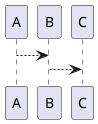

# 📚 LOVRIN CORNELL SYSTEM - Complete Setup Guide
## Ultimate Edition - Comprehensive Documentation

---

## 📋 Table of Contents

1. [Quick Start](#quick-start)
2. [Required Plugins](#required-plugins)
3. [Optional Plugins](#optional-plugins)
4. [CSS Installation](#css-installation)
5. [Template Setup](#template-setup)
6. [LaTeX Suite Configuration](#latex-suite-configuration)
7. [Usage Guide](#usage-guide)
8. [Advanced Features](#advanced-features)
9. [Troubleshooting](#troubleshooting)
10. [Performance Tips](#performance-tips)

---

## 🚀 Quick Start

### What's New in This Version?

✅ **Fixed the main problem**: Left column is now ONLY for text, right column is ONLY for visuals
✅ **Proper column separation**: Clear visual divider between text and visual content
✅ **Hover popup system**: Alternative image display method (optional)
✅ **Cleaned up tags**: Removed unnecessary CSS classes
✅ **Enhanced LaTeX**: 150+ LaTeX snippets with all alphabets and symbols
✅ **Better tables**: Improved styling with Advanced Tables plugin
✅ **Performance optimizations**: Faster rendering and better mobile support
✅ **Sticky summary**: Always visible at the bottom of notes
✅ **Two sub-columns in visual section**: Organized visual content

---

## 🔌 Required Plugins

### Core Plugins (Must Have)

1. **Templater** ⭐⭐⭐⭐⭐
   - Purpose: Template automation with dynamic prompts
   - Settings:
     - Template folder: `Templates/`
     - Enable "Trigger Templater on new file creation"
     - Syntax highlighting: On

2. **Style Settings** ⭐⭐⭐⭐⭐
   - Purpose: Customize CSS variables without editing code
   - No configuration needed - auto-detects CSS variables

3. **Dataview** ⭐⭐⭐⭐⭐
   - Purpose: Dynamic queries and linked note discovery
   - Settings:
     - Enable JavaScript queries: Yes
     - Enable inline queries: Yes
     - Enable inline JavaScript: Yes

### Visual Content Plugins

4. **LaTeX Suite** ⭐⭐⭐⭐⭐
   - Purpose: Fast LaTeX input with auto-expansion
   - **Critical**: Import the JSON file I created for you
   - Settings:
     - Trigger on TAB: Yes
     - Trigger on Space: Optional (your preference)
     - Import snippets from: `.obsidian/latex-suite-snippets.json`

5. **Excalidraw** ⭐⭐⭐⭐⭐
   - Purpose: Hand-drawn diagrams and sketches
   - Settings:
     - Auto-create new drawings: Yes
     - Embed type: PNG (for performance)
     - Default pen color: Match your theme

6. **Charts View** / **Obsidian Charts** ⭐⭐⭐⭐
   - Purpose: Create charts from code blocks
   - Settings: Default settings work fine

7. **PlantUML** ⭐⭐⭐⭐
   - Purpose: Flowcharts, sequence diagrams, UML
   - Settings:
     - Server URL: Use online server or install locally
     - Rendering: SVG format (better quality)

8. **Obsidian Chem** ⭐⭐⭐
   - Purpose: Chemical structure rendering
   - Settings: Default

### Table and Organization Plugins

9. **Advanced Tables** ⭐⭐⭐⭐⭐
   - Purpose: Excel-like table editing
   - Settings:
     - Format on tab: Yes
     - Auto-format tables: Yes

10. **Image Toolkit** / **Image Captions** ⭐⭐⭐⭐
    - Purpose: Zoom, pan, and caption images
    - Settings:
      - View trigger: Click
      - Pin after opening: No

---

## 🎨 Optional Plugins (Highly Recommended)

11. **QuickAdd** ⭐⭐⭐⭐⭐
    - Purpose: Create notes with hotkeys
    - Setup:
      1. Add Choice → Name: "Lovrin Cornell", Type: Template
      2. Template path: `Templates/Lovrin_Cornell_Ultimate.md`
      3. File name format: `{{VALUE:Naslov bilješke}}`
      4. Folder: Your study folder (e.g., `Notes/Medicina/`)
      5. Enable: "Create new file" and "Open new file"
      6. Settings → Hotkeys → Assign hotkey (e.g., `Ctrl+Shift+N`)

12. **Banner** Plugin ⭐⭐⭐⭐
    - Purpose: Beautiful banner images at top of notes
    - Alternative: Use the built-in banner callout in CSS

13. **Calendar** ⭐⭐⭐
    - Purpose: Daily notes and date navigation
    - Good for: Tracking study sessions

14. **Recent Files** ⭐⭐⭐
    - Purpose: Quick access to recent notes

15. **Sliding Panes** ⭐⭐⭐
    - Purpose: Side-by-side note viewing
    - Great for: Comparing notes while studying

---

## 🎨 CSS Installation

### Step 1: Install the CSS Snippet

1. Copy `lovrin-cornell-ultimate.css` to:
   - **Windows**: `YourVault/.obsidian/snippets/`
   - **Mac**: `YourVault/.obsidian/snippets/`
   - **Linux**: `YourVault/.obsidian/snippets/`

2. If the `snippets` folder doesn't exist, create it

3. In Obsidian:
   - Settings → Appearance → CSS snippets
   - Click refresh icon (↻)
   - Enable "lovrin-cornell-ultimate"

### Step 2: Disable Old Snippets

⚠️ **IMPORTANT**: Turn OFF any old Cornell CSS snippets!
- Look for: `cornell.css`, `lovrin-cornell.css`, etc.
- Only keep `lovrin-cornell-ultimate.css` enabled

### Step 3: Restart Obsidian

- Close and reopen Obsidian
- Or: Ctrl+R (Cmd+R on Mac) to reload

---

## 📝 Template Setup

### Installation

1. Copy `Lovrin_Cornell_Ultimate.md` to your `Templates/` folder

2. Configure Templater:
   - Settings → Templater
   - Template folder location: `Templates/`
   - Enable "Trigger Templater on new file creation"

### Template Structure Explanation

```
┌─────────────────────────────────────────────┐
│         BANNER IMAGE (Optional)             │
│              # TITLE                        │
└─────────────────────────────────────────────┘

┌──────────────┬──────────────────────────────┐
│              │                              │
│   CUE        │      MAIN CONTENT            │
│   (Left)     │      (Text only)             │
│              │                              │
│              ├──────────────────────────────┤
│              │   VISUAL COLUMN              │
│              │   ┌─────────┬─────────┐      │
│              │   │ Sub 1   │ Sub 2   │      │
│              │   │Images   │Diagrams │      │
│              │   │Tables   │Charts   │      │
│              │   └─────────┴─────────┘      │
└──────────────┴──────────────────────────────┘

┌─────────────────────────────────────────────┐
│         STICKY SUMMARY (Bottom)             │
│    • Key points                             │
│    • Links to related notes                 │
│    • External resources                     │
└─────────────────────────────────────────────┘
```

---

## ⚡ LaTeX Suite Configuration

### Import Snippets

1. Settings → LaTeX Suite
2. Scroll to "Snippets" section
3. Click "Import snippets"
4. Select: `.obsidian/latex-suite-snippets.json`
5. Confirm import

### Quick Reference: Most Used Snippets

#### Greek Letters
```
alpha → α       beta → β        gamma → γ
delta → δ       epsilon → ε     theta → θ
lambda → λ      mu → μ          pi → π
sigma → σ       omega → ω       phi → φ
```

#### Superscripts & Subscripts
```
sr → x²         cb → x³         rd → x^{}
_  → x_{}       invs → x⁻¹      dag → x†
```

#### Fractions & Roots
```
// → frac{}{} sq → √{}      nrt → ⁿ√{}
```

#### Common Operations
```
sum → Σ         prod → Π       lim → lim
int → ∫         dint → ∫ᵃᵇ     iint → ∬
```

#### Sets & Logic
```
inn → ∈         notin → ∉      sub= → ⊆
and → ∩         orr → ∪        eset → ∅
NN → ℕ          ZZ → ℤ         RR → ℝ
CC → ℂ          QQ → ℚ         exists → ∃
forall → ∀
```

#### Relations
```
>= → ≥          <= → ≤         != → ≠
=== → ≡         approx → ≈     prop → ∝
-> → →          <-> → ↔        => → ⇒
```

#### Calculus
```
par → ∂/∂x      ddt → d/dt     ddx → d/dx
int → ∫ dx      oinf → ∫₀^∞    infi → ∫₋∞^∞
```

#### Matrices
```
pmat → ⎛⎞       bmat → []      vmat → ||
cases → {}      align → align  array → array
```

#### Brackets
```
lr( → ()        lr[ → []       lr{ → {}
lr| → ||        avg → ⟨⟩       norm → |·|
```

---

## 📖 Usage Guide

### Creating a New Note

#### Method 1: Using QuickAdd (Recommended)
1. Press your hotkey (e.g., `Ctrl+Shift+N`)
2. Enter note title
3. Select predmet (subject)
4. Add tags when prompted
5. Template auto-fills!

#### Method 2: Manual Creation
1. Create new note
2. Open command palette (Ctrl+P)
3. Type: "Templater: Insert Template"
4. Select: "Lovrin_Cornell_Ultimate"

### Writing Content

#### Left Column (Text Content)
```markdown
> [!cue] Main Concept

## Section Title

Write your explanations, definitions, and text content here.
- Use bullet points
- Add numbered lists
- Include internal links: [[Related Note]]

> [!cue] Another Key Point

Continue with more text...
```

#### Right Column (Visual Content)
```markdown
> [!lovrin-visuals] Vizualije, tablice, grafovi, slike, dijagrami

<div class="lovrin-visual-block">

<!-- First sub-column -->
<div>

#### Table Example
| Column 1 | Column 2 |
|----------|----------|
| Data 1   | Data 2   |

#### LaTeX Formula
$$
E = mc^2
$$

</div>

<!-- Second sub-column -->
<div>

#### Image
![[image.png|300]]
*Caption for the image*

#### Chart
```chart
type: bar
...
```

</div>

</div>
```

### Adding Different Content Types

#### Tables
Use Advanced Tables plugin for best experience:
```markdown
| Header 1 | Header 2 | Header 3 |
|----------|----------|----------|
| Cell 1   | Cell 2   | Cell 3   |
```

#### Charts
```markdown
```chart
type: line
labels: [A, B, C]
series:
  - title: Series 1
    data: [1, 2, 3]
```
```

#### LaTeX Math
Inline: `$E = mc^2$`
Display: `$$E = mc^2$$`

#### Chemical Formulas
```markdown
```chem
H2SO4
```
```

#### Diagrams (PlantUML)
```markdown

```

#### Images
```markdown
![[image.png|400]]
*Image caption goes here*
```

---

## 🔥 Advanced Features

### 1. Image Popup System (Alternative to Embedded Images)

If you want images NOT to display inline but as popups on hover:

```markdown
<span class="image-popup-trigger" data-image-title="Image Title">
Click here to see image
</span>
```

Then add this to your note:
```css
<style>
.image-popup-trigger:hover::before {
  content: '';
  position: absolute;
  width: 400px;
  height: 300px;
  background: url([[your-image.png]]);
  background-size: contain;
  z-index: 1000;
}
</style>
```

### 2. Custom Color Schemes

Edit CSS variables in your snippet:
```css
:root {
  --lovrin-accent: #4a90e2;  /* Change to your color */
  --lovrin-bg-visual: rgba(245, 245, 250, 0.4);
  /* ... more variables ... */
}
```

### 3. Dataview Queries

List all Cornell notes from specific subject:
```markdown
```dataview
TABLE created, tags
FROM ""
WHERE contains(predmet, "Patologija")
  AND contains(tags, "cornell")
SORT created DESC
```
```

### 4. Linked Notes Network

Create a knowledge graph:
```markdown
**Prerequisite**: [[Basic Concept]]
**Current Topic**: This note
**Next Steps**: [[Advanced Topic 1]], [[Advanced Topic 2]]
```

---

## 🐛 Troubleshooting

### Problem: Columns not showing / no visual separation

**Solution**:
1. Check CSS snippet is enabled
2. Make sure note has `lovrin-cornell` in cssclasses
3. Restart Obsidian (Ctrl+R)
4. Disable other Cornell CSS snippets

### Problem: LaTeX snippets not expanding

**Solution**:
1. Verify LaTeX Suite plugin is installed and enabled
2. Check if snippets JSON was imported correctly
3. Settings → LaTeX Suite → Verify "Trigger on TAB" is enabled
4. Try typing trigger + pressing TAB (not just typing trigger)

### Problem: Charts not rendering

**Solution**:
1. Install Charts View plugin
2. Check syntax in chart code block
3. Make sure block starts with ```chart

### Problem: Images too large

**Solution**:
Add size parameter: `![[image.png|300]]` (300px width)

### Problem: PlantUML diagrams not showing

**Solution**:
1. Settings → PlantUML → Set server URL
2. Use online server: `https://www.plantuml.com/plantuml`
3. Or install PlantUML locally (requires Java)

### Problem: Summary not sticky

**Solution**:
1. Make sure summary callout is at the bottom of note
2. Check: `> [!summary]` (not `> [!Summary]` - lowercase!)

### Problem: Tables look messy

**Solution**:
1. Install Advanced Tables plugin
2. Use table formatting command (Ctrl+P → "Format table")
3. Or manually align with pipes `|`

---

## ⚡ Performance Tips

### For Large Vaults (1000+ notes)

1. **Limit Dataview queries**: Don't query entire vault, use specific folders
   ```dataview
   FROM "Notes/Medicina"  # Specific folder
   LIMIT 20  # Don't show everything
   ```

2. **Optimize images**:
   - Resize large images before importing
   - Use JPEG for photos, PNG for diagrams
   - Compress images (recommended: <500KB each)

3. **Lazy-load Excalidraw**:
   - Settings → Excalidraw → "Embed as PNG"
   - Faster rendering, less memory

4. **Disable unnecessary plugins**:
   - Only enable what you actually use
   - Check Settings → Community Plugins

5. **Use CSS containment**:
   - Already included in the CSS for better performance

### For Mobile Devices

The CSS is responsive and mobile-friendly:
- < 900px: Cue column stacks vertically
- < 700px: Visual sub-columns stack vertically
- Optimized font sizes and spacing

---

## 📚 Additional Plugin Recommendations

### Study-Specific

- **Spaced Repetition**: For flashcards
- **Review**: For scheduled note review
- **Kanban**: Visual task boards

### Organization

- **Folder Note**: Create index notes for folders
- **Tag Wrangler**: Rename/merge tags easily
- **Note Refactor**: Split long notes

### Writing

- **Dictionary**: Look up words while writing
- **Footnote Shortcut**: Easy footnote creation
- **Paste URL into selection**: Link text quickly

---

## 🎯 Best Practices

### 1. Naming Conventions

```
Good:
- Patologija - Upala
- Matematika - Derivacije
- Fizika - Termodinamika 1

Bad:
- note1
- biljeska
- temp
```

### 2. Tagging Strategy

```markdown
tags:
  - cornell
  - lovrin
  - patologija
  - upala
  - med-school
```

Keep 3-6 tags per note. Use hierarchical tags: `#medicina/patologija`

### 3. Linking Strategy

- Link concepts, not just topics
- Create index notes for subjects
- Use backlinks panel to discover connections

### 4. Regular Maintenance

- Weekly: Review and update links
- Monthly: Consolidate similar notes
- Quarterly: Archive old/irrelevant notes

---

## 📞 Getting Help

If something doesn't work:

1. Check this guide's Troubleshooting section
2. Verify all plugins are installed and updated
3. Check Obsidian forums: https://forum.obsidian.md
4. LaTeX Suite docs: https://github.com/artisticat1/obsidian-latex-suite

---

## ✅ Quick Checklist

Before creating your first note, make sure:

- [ ] CSS snippet installed and enabled
- [ ] Old Cornell snippets disabled
- [ ] Templater plugin installed and configured
- [ ] LaTeX Suite installed with JSON imported
- [ ] Template file in Templates/ folder
- [ ] At least one banner image in vault
- [ ] QuickAdd set up (optional but recommended)
- [ ] Obsidian restarted after setup

---

## 🎉 You're Ready!

Everything is set up! Try creating your first note with:
1. QuickAdd hotkey OR
2. Command palette → "Templater: Insert Template"

**Good luck with your studies! 📚✨**

---

*Last updated: 2026-03-24*
*Version: Ultimate Edition 1.0*
