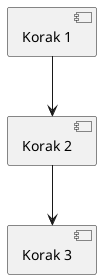

---
cssclasses:
  - lovrin-cornell
  - banner-image
tags:
  - cornell
  - lovrin
  - <% tp.system.prompt("Tag 1 (npr. patologija/imunologija)") %>
created: <% tp.file.creation_date("YYYY-MM-DD HH:mm") %>
modified: <% tp.file.last_modified_date("YYYY-MM-DD HH:mm") %>
predmet: <% tp.system.suggester(["Patologija","Imunologija","Patofiziologija","Farmakologija","Matematika","Fizika","Kemija","Biologija"], ["Patologija","Imunologija","Patofiziologija","Farmakologija","Matematika","Fizika","Kemija","Biologija"]) %>
banner: banner-cornellU.jpg
---

> [!banner-image] ![[banner-cornellU.jpg]]
# <% tp.file.title %>

> [!cue] Glavne teze
> - Ključni pojam 1
> - Ključni pojam 2
> - Ključni pojam 3
> - Povezani predmeti: [[Link 1]], [[Link 2]]

---

## 📝 Glavni sadržaj - SAMO TEKST

> [!cue] Uvod

**Što pokušavamo razumjeti?**
Ovdje pišeš samo tekst. Objašnjenja, definicije, koncepte. Bez formula, bez slika, bez tablica - samo čisti tekst.

**Detaljno objašnjenje:**
Koristi paragrafe, liste, poveznice. Objašnjavaj koncepte riječima. Sve vizualno ide u sljedeću sekciju.

> [!cue] Pojam 1

**Definicija:**
Tekstualno objašnjenje prvog pojma. Koristi **bold** za naglašavanje, *italic* za termine, ali bez LaTeX-a ili slika.

**Razrada:**
- Točka 1: Objašnjenje
- Točka 2: Daljnja razrada
- Točka 3: Primjena

> [!cue] Pojam 2

**Povezivanje koncepata:**
Objasni kako se koncepti međusobno povezuju. Koristi interne linkove: [[Povezana tema]], [[Prethodni koncept]].

**Praktična primjena:**
Opiši gdje i kako se koristi, ali samo tekstom. Formule i dijagrami idu dolje.

> [!cue] Ključna teza

**Razrada:**
Dublja analiza. Koristi liste, odsječke, ali SAMO tekst u glavnom dijelu.

**Zaključak:**
Tekstualni sažetak ključnih točaka.

---

## 🎨 SVE Vizualizacije - UNIFIED NON-TEXT Sekcija

> [!lovrin-visuals] Slike, Tablice, Formule, Grafovi, Dijagrami, Kod - SVE OVDJE

<div class="lovrin-visual-block">

<!-- ===============================================
     VAŽNO: SVE non-text elemente stavljamo ovdje
     NE organiziramo "slika lijevo, tablica desno"
     SVE je unified - jedna kategorija: "nije tekst"
     =============================================== -->

<div>

#### 📊 Tablice

| Kategorija | Vrijednost | Napomena |
|------------|-----------|----------|
| Tip A | 80% | Dominantan |
| Tip B | 15% | Sekundaran |
| Tip C | 5% | Rijedak |

#### 🧮 LaTeX Formule

$$
\text{Glavna formula} = \int_{0}^{\infty} f(x) dx
$$

$$
\frac{\partial u}{\partial t} = \alpha \nabla^2 u
$$

#### 📈 Graf

```chart
type: line
labels: [A, B, C, D, E]
series:
  - title: Vrijednosti
    data: [10, 25, 45, 60, 75]
```

</div>

<div>

#### 🖼️ Slike

![[slika-primjer.png|350]]
*Opis slike*

#### 🔷 Dijagrami



#### ⚗️ Kemijske strukture

```chem
CC(=O)O
```
*Octena kiselina*

#### 💻 Kod

```python
def example():
    return "Hello"
```

</div>

</div>

<!-- Svi vizualni elementi SU ZAJEDNO
     Ne dijelimo ih po vrsti
     Svi su unified: "non-text" -->

---

## 🔗 Dodatni resursi i poveznice

> [!cue] Eksterni resursi

### Video materijali
- [Video 1: Uvod u temu](https://youtube.com/example1)
- [Video 2: Napredni koncepti](https://youtube.com/example2)
- [Video 3: Praktična primjena](https://youtube.com/example3)

### Članci i dokumentacija
- [Službena dokumentacija](https://example.com/docs)
- [Znanstveni članak](https://example.com/paper)
- [Blog post o temi](https://example.com/blog)

### Povezane bilješke
- [[Povezana tema 1]]
- [[Povezana tema 2]]
- [[Napredni koncepti]]
- [[Praktični primjeri]]

---

## 📋 Dataview: Pregled povezanih bilješki

```dataview
TABLE predmet, created as "Datum", tags
FROM ""
WHERE contains(tags, "lovrin") AND contains(tags, "cornell")
SORT created DESC
LIMIT 10
```

---

## 📌 Zadaci i To-Do lista

> [!cue] Zadaci za ponavljanje

- [ ] Ponovi ključne pojmove
- [ ] Napravi dodatne bilješke o [[Povezana tema]]
- [ ] Istraži dodatne resurse
- [ ] Kreiraj Excalidraw dijagram
- [ ] Rješavaj vježbe iz [[Vježbe]]

---

> [!summary] 📝 Sažetak (Sticky na dnu)
> 
> **Ključni zaključci:**
> - Glavna pouka 1
> - Glavna pouka 2
> - Glavna pouka 3
> 
> **Povezivanje znanja:**
> - [[Prethodni koncept]] → **Ova tema** → [[Sljedeći koncept]]
> 
> **Za dublje učenje:**
> - Ponovi: [[Osnove]]
> - Proširi: [[Napredne teme]]
> - Primijeni: [[Praktične vježbe]]
> 
> **Vanjski resursi:**
> - [Članak](https://example.com)
> - [Video](https://youtube.com/example)
> - [Dokumentacija](https://docs.example.com)
