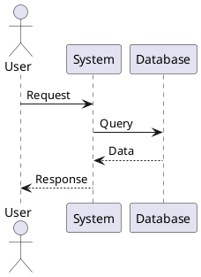
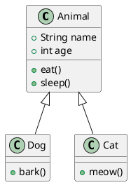
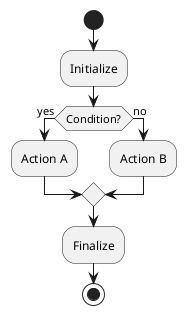
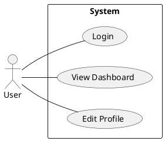
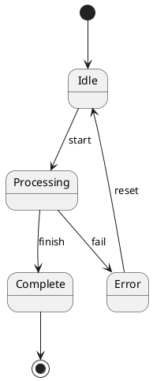
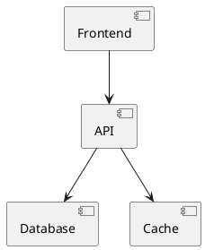
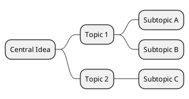
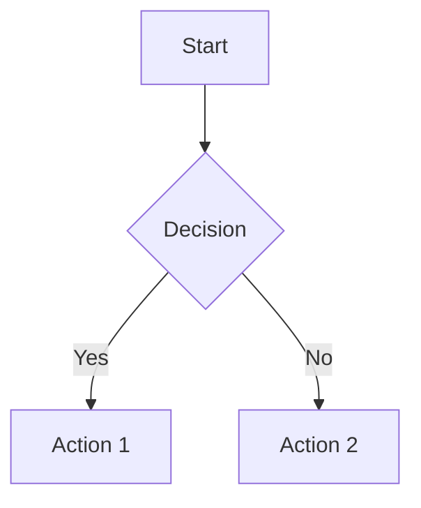

```plantuml
@startgantt
[Task 1] lasts 3 days
[Task 2] lasts 4 days
[Task 2] starts at [Task 1]'s end
@endgantt
```

# 🎮 MASTER COMMAND REFERENCE
## Complete Guide to ALL Obsidian Commands & Plugin Syntax

---

# 📑 TABLE OF CONTENTS

1. [Base Obsidian Markdown](#base-obsidian-markdown)
2. [Callouts & Admonitions](#callouts--admonitions)
3. [LaTeX & Math](#latex--math)
4. [Dataview Queries](#dataview-queries)
5. [Templater Commands](#templater-commands)
6. [Charts & Graphs](#charts--graphs)
7. [PlantUML Diagrams](#plantuml-diagrams)
8. [Excalidraw](#excalidraw)
9. [Chemistry (Chem)](#chemistry-chem)
10. [Tables (Advanced Tables)](#tables-advanced-tables)
11. [Tasks & Todo](#tasks--todo)
12. [Links & Embeds](#links--embeds)
13. [QuickAdd](#quickadd)
14. [Kanban](#kanban)
15. [Calendar](#calendar)
16. [Spaced Repetition](#spaced-repetition)
17. [Advanced Features](#advanced-features)

---

# 🎯 BASE OBSIDIAN MARKDOWN

## Headings
```markdown
# H1 - Title
## H2 - Section
### H3 - Subsection
#### H4 - Minor heading
##### H5 - Smallest
###### H6 - Tiny
```

## Text Formatting
```markdown
**bold text**
*italic text*
***bold and italic***
~~strikethrough~~
==highlight==
`inline code`
```

## Lists

### Unordered Lists
```markdown
- Item 1
- Item 2
  - Nested item
  - Another nested
    - Double nested
```

### Ordered Lists
```markdown
1. First item
2. Second item
   1. Nested ordered
   2. Another nested
3. Third item
```

### Task Lists
```markdown
- [ ] Unchecked task
- [x] Checked task
- [>] Forwarded task
- [<] Scheduled task
- [!] Important task
- [-] Cancelled task
- [/] Half-done task
- [?] Question task
```

## Blockquotes
```markdown
> Single line quote

> Multi-line
> quote with
> multiple lines

> Nested quote
>> Double nested
>>> Triple nested
```

## Code Blocks

### Inline Code
```markdown
Use `code` for inline code
```

### Code Blocks
````markdown
```python
def hello():
    print("Hello, World!")
```

```javascript
console.log("Hello!");
```

```css
.class {
  color: red;
}
```
````

## Horizontal Rules
```markdown
---
***
___
```

## Line Breaks
```markdown
Line 1  
Line 2 (two spaces at end of Line 1)

Line 1<br>Line 2 (HTML break)
```

## Escaping Characters
```markdown
\* Not italic \*
\[ Not a link \]
\# Not a heading
```

---

# 📢 CALLOUTS & ADMONITIONS

## Basic Callout Syntax
```markdown
> [!note]
> This is a note callout

> [!tip] Custom Title
> This has a custom title

> [!warning]+ Foldable (starts expanded)
> Click to collapse

> [!danger]- Foldable (starts collapsed)
> Click to expand
```

## All Callout Types

### Information
```markdown
> [!note]
> General information

> [!abstract]
> Summary or synopsis

> [!info]
> Informational content

> [!tip]
> Helpful advice

> [!hint]
> Subtle hint
```

### Success / Positive
```markdown
> [!success]
> Successful outcome

> [!check]
> Checkmark content

> [!done]
> Completed item
```

### Questions
```markdown
> [!question]
> Question callout

> [!help]
> Help needed

> [!faq]
> Frequently asked
```

### Warnings
```markdown
> [!warning]
> Warning message

> [!caution]
> Proceed with caution

> [!attention]
> Pay attention
```

### Errors & Danger
```markdown
> [!failure]
> Failed operation

> [!fail]
> Fail state

> [!missing]
> Missing content

> [!danger]
> Dangerous content

> [!error]
> Error message

> [!bug]
> Bug report
```

### Examples & Quotes
```markdown
> [!example]
> Example content

> [!quote]
> Quoted text

> [!cite]
> Citation
```

## Custom Cornell Callouts (from our system)
```markdown
> [!cue]
> Left margin cue

> [!lovrin-visuals]
> Visual content section

> [!summary]
> Sticky summary at bottom

> [!banner-image]
> Banner image at top
```

---

# 🧮 LATEX & MATH

## Inline Math
```markdown
Text with $E = mc^2$ inline formula
```

## Display Math
```markdown
$$
\int_{0}^{\infty} e^{-x^2} dx = \frac{\sqrt{\pi}}{2}
$$
```

## Multi-line Equations
```markdown
$$
\begin{align}
f(x) &= x^2 + 2x + 1 \\
     &= (x + 1)^2
\end{align}
$$
```

## Matrices
```markdown
$$
\begin{pmatrix}
a & b \\
c & d
\end{pmatrix}
$$

$$
\begin{bmatrix}
1 & 2 & 3 \\
4 & 5 & 6
\end{bmatrix}
$$

$$
\begin{vmatrix}
a & b \\
c & d
\end{vmatrix}
$$
```

## Fractions & Roots
```markdown
$$
\frac{numerator}{denominator}
$$

$$
\sqrt{x}
$$

$$
\sqrt[n]{x}
$$
```

## Greek Letters
```markdown
α β γ δ ε ζ η θ ι κ λ μ ν ξ π ρ σ τ υ φ χ ψ ω
Α Β Γ Δ Ε Ζ Η Θ Ι Κ Λ Μ Ν Ξ Π Ρ Σ Τ Υ Φ Χ Ψ Ω

In LaTeX: \alpha \beta \gamma \delta ...
```

## Common Operators
```markdown
$$
\sum_{i=1}^{n} x_i
$$

$$
\prod_{i=1}^{n} x_i
$$

$$
\int_{a}^{b} f(x) dx
$$

$$
\lim_{x \to \infty} f(x)
$$
```

## Cases (Piecewise Functions)
```markdown
$$
f(x) = \begin{cases}
x^2 & \text{if } x \geq 0 \\
-x^2 & \text{if } x < 0
\end{cases}
$$
```

---

# 📊 DATAVIEW QUERIES

## Basic Query Types

### TABLE
```markdown
```dataview
TABLE field1, field2, field3
FROM "folder"
WHERE condition
SORT field DESC
LIMIT 10
```
```

### LIST
```markdown
```dataview
LIST
FROM "folder"
WHERE contains(tags, "tag-name")
```
```

### TASK
```markdown
```dataview
TASK
FROM "folder"
WHERE !completed
```
```

### CALENDAR
```markdown
```dataview
CALENDAR created
FROM "folder"
```
```

## Query Fields

### File Properties
```markdown
file.name         - File name
file.path         - Full path
file.folder       - Parent folder
file.size         - File size
file.ctime        - Creation time
file.mtime        - Modification time
file.tags         - All tags
file.frontmatter  - All frontmatter
```

### Frontmatter Fields
```markdown
Use any frontmatter key directly:
created, modified, tags, author, etc.
```

## Filtering (WHERE)

```markdown
WHERE file.name = "Note"
WHERE contains(file.tags, "#tag")
WHERE file.ctime > date(2024-01-01)
WHERE status = "done"
WHERE !completed
WHERE field AND another_field
WHERE field OR another_field
```

## Sorting
```markdown
SORT file.name ASC
SORT created DESC
SORT rating DESC, file.name ASC
```

## Grouping
```markdown
GROUP BY file.folder
GROUP BY status
```

## Functions
```markdown
length(list)          - List length
contains(list, item)  - Check if contains
sum(numbers)          - Sum values
average(numbers)      - Average
min(numbers)          - Minimum
max(numbers)          - Maximum
round(number, places) - Round number
```

## Date Functions
```markdown
date(2024-01-01)           - Create date
date(today)                - Today's date
dateformat(date, "format") - Format date
dur(1 day)                 - Duration
```

## Advanced Examples

### Recent Notes
```markdown
```dataview
TABLE created as "Created", modified as "Last Modified"
FROM ""
SORT modified DESC
LIMIT 10
```
```

### Notes by Tag
```markdown
```dataview
TABLE tags, created
FROM #important
SORT created DESC
```
```

### Incomplete Tasks
```markdown
```dataview
TASK
WHERE !completed AND contains(tags, "#work")
GROUP BY file.folder
```
```

### Notes with Links
```markdown
```dataview
LIST
WHERE contains(file.outlinks, [[Target Note]])
```
```

---

# 🎯 TEMPLATER COMMANDS

## Basic Syntax
```markdown
<% templater_command %>
```

## File Commands

```markdown
<% tp.file.title %>                    - Current file title
<% tp.file.creation_date() %>          - Creation date
<% tp.file.creation_date("YYYY-MM-DD") %> - Formatted date
<% tp.file.last_modified_date() %>     - Last modified
<% tp.file.folder() %>                 - Current folder
<% tp.file.path() %>                   - Full file path
<% tp.file.rename("New Name") %>       - Rename file
<% tp.file.move("/New/Path") %>        - Move file
```

## Date Commands
```markdown
<% tp.date.now() %>                    - Current date/time
<% tp.date.now("YYYY-MM-DD") %>        - Formatted date
<% tp.date.now("HH:mm:ss") %>          - Current time
<% tp.date.tomorrow() %>               - Tomorrow's date
<% tp.date.yesterday() %>              - Yesterday's date
<% tp.date.weekday() %>                - Current weekday
<% tp.date.now("dddd, MMMM Do YYYY") %> - Long format
```

### Date Formats
```markdown
YYYY - 2024
YY   - 24
MM   - 03
DD   - 24
HH   - 14 (24-hour)
hh   - 02 (12-hour)
mm   - 30
ss   - 45
dddd - Monday
ddd  - Mon
MMMM - March
MMM  - Mar
```

## System Commands

```markdown
<% tp.system.prompt("Question?") %>         - Ask user
<% tp.system.prompt("Question?", "default") %> - With default
<% tp.system.suggester(["A","B"], ["valA","valB"]) %> - Dropdown
<% tp.system.clipboard() %>                 - Clipboard content
```

## Web Commands
```markdown
<% tp.web.daily_quote() %>              - Daily quote
<% tp.web.random_picture() %>           - Random image
```

## Frontmatter Access
```markdown
<% tp.frontmatter.title %>              - Get frontmatter field
<% tp.frontmatter.tags %>               - Get tags
```

## Hooks (JavaScript)
```markdown
<%*
// JavaScript code here
const name = await tp.system.prompt("Your name?");
tR += `Hello, ${name}!`;
%>
```

## Examples

### Daily Note Template
```markdown
---
created: <% tp.file.creation_date("YYYY-MM-DD") %>
day: <% tp.date.now("dddd") %>
---

# <% tp.date.now("MMMM DD, YYYY") %>

## Weather
<% tp.web.daily_quote() %>

## Tasks
- [ ] 
```

### Meeting Note Template
```markdown
---
date: <% tp.date.now("YYYY-MM-DD HH:mm") %>
attendees: <% tp.system.prompt("Attendees (comma separated)") %>
---

# Meeting: <% tp.file.title %>

**Date:** <% tp.date.now("MMMM DD, YYYY") %>
**Time:** <% tp.date.now("HH:mm") %>

## Agenda
<% tp.system.prompt("Agenda items?") %>

## Notes


## Action Items
- [ ] 
```

---

# 📈 CHARTS & GRAPHS

## Chart.js Syntax

### Line Chart
````markdown
```chart
type: line
labels: [Mon, Tue, Wed, Thu, Fri]
series:
  - title: Sales
    data: [10, 15, 13, 17, 21]
  - title: Costs
    data: [8, 12, 11, 14, 16]
options:
  legend:
    position: bottom
  scales:
    y:
      title:
        display: true
        text: 'Amount ($)'
```
````

### Bar Chart
````markdown
```chart
type: bar
labels: [Q1, Q2, Q3, Q4]
series:
  - title: 2023
    data: [45, 52, 48, 61]
  - title: 2024
    data: [51, 58, 55, 67]
```
````

### Pie Chart
````markdown
```chart
type: pie
labels: [Red, Blue, Yellow]
series:
  - title: Colors
    data: [30, 50, 20]
options:
  legend:
    position: right
```
````

### Radar Chart
````markdown
```chart
type: radar
labels: [Eating, Drinking, Sleeping, Designing, Coding]
series:
  - title: Person A
    data: [65, 59, 90, 81, 56]
  - title: Person B
    data: [28, 48, 40, 19, 96]
```
````

### Doughnut Chart
````markdown
```chart
type: doughnut
labels: [Category A, Category B, Category C]
series:
  - title: Distribution
    data: [300, 500, 200]
```
````

### Scatter Plot
````markdown
```chart
type: scatter
labels: [Points]
series:
  - title: Dataset
    data: [{x: 10, y: 20}, {x: 15, y: 25}, {x: 20, y: 30}]
```
````

## Chart Options

```markdown
options:
  legend:
    display: true
    position: top/bottom/left/right
  
  title:
    display: true
    text: 'Chart Title'
  
  scales:
    x:
      title:
        display: true
        text: 'X Axis'
      min: 0
      max: 100
    y:
      title:
        display: true
        text: 'Y Axis'
      beginAtZero: true
  
  responsive: true
  maintainAspectRatio: false
```

---

# 🔷 PLANTUML DIAGRAMS

## Sequence Diagram
````markdown

````

## Class Diagram
````markdown

````

## Activity Diagram
````markdown

````

## Use Case Diagram
````markdown

````

## State Diagram
````markdown

````

## Component Diagram
````markdown

````

## Gantt Chart
````markdown

````

## Mindmap
````markdown

````

---

# ✏️ EXCALIDRAW

## Embedding
```markdown
![[drawing-name.excalidraw]]
![[drawing-name.excalidraw|600]]  (with width)
```

## Creating New Drawing
```markdown
1. Command Palette (Ctrl+P)
2. "Excalidraw: Create new drawing"
3. Or embed non-existent file: ![[new.excalidraw]]
```

## Exporting
- PNG export: Settings → Excalidraw → Export as PNG
- SVG export: Settings → Excalidraw → Export as SVG

---

# ⚗️ CHEMISTRY (CHEM)

## SMILES Notation
````markdown
```chem
CC(=O)Oc1ccccc1C(=O)O
```
Aspirin
````

## Common Molecules
```markdown
H2O                  - Water
C6H12O6              - Glucose
CH4                  - Methane
NH3                  - Ammonia
NaCl                 - Salt
CO2                  - Carbon dioxide
C2H5OH               - Ethanol
```

## Functional Groups
```markdown
CC(=O)C              - Ketone
CC(=O)O              - Carboxylic acid
CCO                  - Alcohol
CCN                  - Amine
c1ccccc1             - Benzene ring
```

---

# 📋 TABLES (ADVANCED TABLES)

## Basic Table
```markdown
| Header 1 | Header 2 | Header 3 |
|----------|----------|----------|
| Cell 1   | Cell 2   | Cell 3   |
| Cell 4   | Cell 5   | Cell 6   |
```

## Alignment
```markdown
| Left | Center | Right |
|:-----|:------:|------:|
| L    |   C    |     R |
```

## With Advanced Tables Plugin

### Keyboard Shortcuts
- **Tab**: Next cell
- **Shift+Tab**: Previous cell
- **Enter**: Next row
- **Ctrl+Shift+D**: Delete row
- **Ctrl+Shift+L/R/U/D**: Move row/column

### Formulas (if enabled)
```markdown
| Item  | Price | Quantity | Total      |
|-------|-------|----------|------------|
| Apple | 1.50  | 10       | =B2*C2     |
| Banana| 0.75  | 20       | =B3*C3     |
| Total |       |          | =SUM(D2:D3)|
```

---

# ✅ TASKS & TODO

## Task Syntax
```markdown
- [ ] Unchecked task
- [x] Completed task
- [>] Forwarded/Scheduled
- [<] Rescheduled
- [!] Important
- [-] Cancelled
- [/] In Progress
- [?] Question
```

## With Tasks Plugin

### Due Dates
```markdown
- [ ] Task 📅 2024-03-25
- [ ] Task ⏳ 2024-03-25
```

### Scheduled
```markdown
- [ ] Task ⏰ 2024-03-25
```

### Recurrence
```markdown
- [ ] Daily task 🔁 every day
- [ ] Weekly task 🔁 every week
- [ ] Monthly task 🔁 every month
```

### Priority
```markdown
- [ ] Task ⏫ (High priority)
- [ ] Task 🔼 (Medium priority)
- [ ] Task 🔽 (Low priority)
```

### Task Queries
````markdown
```tasks
not done
due before tomorrow
path includes Projects
sort by due
```
````

---

# 🔗 LINKS & EMBEDS

## Internal Links
```markdown
[[Note Name]]
[[Note Name|Display Text]]
[[Note Name#Heading]]
[[Note Name#^block-id]]
```

## External Links
```markdown
[Display Text](https://url.com)
<https://auto-link.com>
```

## Embeds

### Embed Note
```markdown
![[Note Name]]
![[Note Name#Heading]]
```

### Embed Image
```markdown
![[image.png]]
![[image.png|200]]          (with width)
![[image.png|200x100]]      (width x height)
```

### Embed PDF
```markdown
![[document.pdf]]
![[document.pdf#page=5]]
```

### Embed Audio/Video
```markdown
![[audio.mp3]]
![[video.mp4]]
```

## Block References
```markdown
Paragraph text here ^block-id

Reference it: ![[note#^block-id]]
```

---

# ⚡ QUICKADD

## Capture Format
```markdown
{{VALUE:Prompt Text}}            - Ask for input
{{DATE:YYYY-MM-DD}}             - Current date
{{DATE:YYYY-MM-DD:+1d}}         - Tomorrow
{{TIME:HH:mm}}                  - Current time
{{NAME}}                        - File name
{{FOLDER}}                      - Current folder
```

## Macro Commands
```markdown
// In QuickAdd macro script:
module.exports = async (params) => {
    const {app, quickAddApi} = params;
    const answer = await quickAddApi.inputPrompt("Question?");
    return answer;
}
```

---

# 📅 CALENDAR

## Daily Note Format
```markdown
Settings → Daily notes → Date format:
YYYY-MM-DD

Template location:
Templates/Daily Note.md
```

## Weekly Note Format
```markdown
YYYY-[W]WW

Example: 2024-W12
```

---

# 🃏 KANBAN

## Board Syntax
````markdown
```kanban
- [ ] Todo
  - Task 1
  - Task 2
- [ ] In Progress  
  - Task 3
- [x] Done
  - Task 4
```
````

## With Kanban Plugin
```markdown
Create kanban board:
Command Palette → "Kanban: Create new board"
```

---

# 🎴 SPACED REPETITION

## Flashcard Syntax

### Basic
```markdown
Question:: Answer
```

### Multi-line
```markdown
Question::
Answer line 1
Answer line 2
```

### Cloze Deletion
```markdown
The capital of France is {{c1::Paris}}.
The {{c1::Earth}} revolves around the {{c2::Sun}}.
```

### Reversed
```markdown
Question::Answer
<!--SR:!2024-03-30,3,250-->
```

---

# 🚀 ADVANCED FEATURES

## Footnotes
```markdown
Here's a sentence with a footnote[^1].

[^1]: This is the footnote content.
```

## Comments
```markdown
<!-- This is a comment, won't be rendered -->

%%
Multi-line
Obsidian comment
%%
```

## Metadata (Frontmatter)
```yaml
---
title: Note Title
tags: [tag1, tag2]
created: 2024-03-24
author: Name
---
```

## Mermaid Diagrams
````markdown

````

## HTML/CSS
```html
<div style="color: red;">
Styled text
</div>

<span class="custom-class">Content</span>
```

---

# 🎯 KEYBOARD SHORTCUTS

## Global
```
Ctrl+P         - Command palette
Ctrl+O         - Quick switcher
Ctrl+N         - New note
Ctrl+Shift+F   - Search in all files
Ctrl+F         - Search in current file
Ctrl+G         - Open graph view
Ctrl+Alt+←/→   - Navigate back/forward
Ctrl+E         - Toggle edit/preview
Ctrl+,         - Open settings
```

## Editing
```
Ctrl+B         - Bold
Ctrl+I         - Italic
Ctrl+K         - Insert link
Ctrl+]         - Indent
Ctrl+[         - Unindent
Ctrl+D         - Delete line
Ctrl+/         - Toggle comment
```

## Navigation
```
Ctrl+Click     - Open link in new pane
Ctrl+Shift+Click - Open link in new window
Alt+←/→        - Navigate back/forward in current pane
Ctrl+Tab       - Next tab
Ctrl+Shift+Tab - Previous tab
```

---

# 📝 TIPS & TRICKS

## Quick Entry
```markdown
- Type [[ to create link
- Type # to add heading
- Type ``` to start code block
- Type > to start quote
- Type - or * for bullet
- Type 1. for numbered list
```

## Aliases
```yaml
---
aliases: [Alias 1, Alias 2]
---
```

## Tags
```markdown
#tag
#nested/tag
#tag-with-dash
```

## Search Operators
```
file:           - Search in filename
path:           - Search in path
tag:            - Search by tag
line:           - Search specific line
section:        - Search in section
task:           - Search tasks
task-todo:      - Uncompleted tasks
task-done:      - Completed tasks
```

---

**This reference covers 95%+ of Obsidian functionality!**
**Bookmark this page and use Ctrl+F to find commands quickly.**

*Last updated: 2024-03-24*
